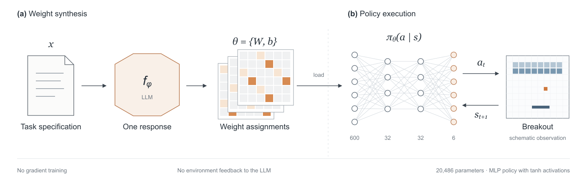

<p align="center">
  
</p>

<h1 align="center">A modular runtime for weight-space programming.</h1>

<p align="center">
  Model-generated parameters. Executable policies. Inspectable evidence.
</p>

<p align="center">
  <a href="#architecture">Architecture</a> ·
  <a href="#try-it">Quick start</a> ·
  <a href="docs/guide.md">Technical guide</a> ·
  <a href="docs/protocol.md">Research protocol</a>
</p>

**Ember** is a Python runtime for **weight-space programming**: using large language models (LLMs) to write neural-network weights directly.
It combines weight editing, typed orchestration, policy execution, and provider-specific evidence checks.

## Architecture

<p align="center">
  
</p>

<p align="center"><sub>Figure 1. One-shot weight synthesis (a) and neural policy execution (b). Drawings are schematic.</sub></p>

**Policies:** Breakout and Asterix · 20,486 parameters each · `600 → 32 → 32 → 6`.
The Python core composes typed `Module` calls through scoped `Context` settings.

<p align="center">
  <a href="docs/assets/architecture.svg">SVG</a> ·
  <a href="docs/assets/architecture.png">PNG</a> ·
  <a href="docs/assets/architecture.pdf">PDF</a>
</p>

## Try it

Use Python 3.12+ and [uv](https://docs.astral.sh/uv/). Run these commands from the project root:

Built-in playgrounds are **Breakout** and **Asterix**. Breakout is the default; select Asterix with `--experiment asterix`.

```sh
make sync
uv run ember list
uv run ember parity
uv run ember parity --experiment asterix
```

The checkout includes the pinned inputs and saved runs. No model request is needed to inspect or replay them.

**Replay the saved Astra network:**

```sh
uv run ember replay \
  --run resources/breakout/runs/astra-20261104T181934Z \
  --output resources/breakout/runs/astra-20261104T181934Z/astra-preview.html
```

This writes `astra-preview.html` and keeps the saved `breakout.html`. It replaces `astra-preview.html` if it already exists.
Without `--output`, `--run` writes `breakout.html` in the run folder and replaces the saved replay.
Use `play` instead of `replay` to also open the result in your browser.
On a terminal, a progress bar on stderr shows the steps and score. Stdout keeps the JSON result.

**Replay the author’s published weights:**

```sh
uv run ember replay \
  --network resources/breakout/runs/author/hand.npz \
  --output resources/breakout/runs/author/author-preview.html
```

This replaces `author-preview.html` if it already exists.
With `--network`, an explicit output path is required. Keep generated artifacts in the corresponding run folder.

**Run a small reconstructed diagnostic:**

```sh
uv run ember evaluate \
  --run resources/breakout/runs/astra-20261104T181934Z \
  --reconstructed --episodes 100 \
  --output resources/breakout/runs/astra-20261104T181934Z/diagnostic.json
```

A replay shows one episode. An evaluation measures many episodes. Their scores answer different questions.

## Generate a new network

Install and authenticate the Codex CLI first. Choose a **new output folder** for every model request.

```sh
uv run ember run \
  --provider codex --model gpt-6-astra --mode comparison \
  --output resources/breakout/runs/astra-new --execute
```

Omit `--execute` to prepare the command without making an inference request.
On a terminal, a live panel on stderr shows the preflight, model thinking, and audit stages. Stdout keeps the JSON record.
Strict mode is the default; it blocks execution unless the pinned context and an empty tool inventory are established.
The explicit comparison mode permits execution with declared deviations and verifies the actual Codex request/response trace.

```sh
uv run ember audit \
  --provider codex --mode comparison \
  --run resources/breakout/runs/astra-new
```

Claude uses the same runner interface. Its comparison audit uses different evidence; see the [provider protocol](docs/protocol.md#labelled-claude-comparisons).

## Evidence, with limits

The retained [Astra run](resources/breakout/runs/astra-20261104T181934Z/) completed with **one inference, zero attempted tool calls, and 182 applied edits**.
Four tool schemas were advertised, and two extra messages were present; `prompt_context_matches` was `false`.
Zero observed calls does not establish unavailable tools or an exact author reproduction.

The original research evaluator is unavailable. Ember’s evaluation results are **reconstructed diagnostics** and record `evaluator_matches_authors: false`. Replay files do not record that field.
A single replay, a nearby score, or matching tensors does not prove evaluator equivalence.
See the [saved results and verification limits](docs/protocol.md#retained-results) before comparing runs.

The public repository includes saved weights, replays, run metadata, and audit summaries.
Raw traces, event logs, and preflight context stay local because they can contain private request context. Re-auditing the retained Astra run requires those local files.

## Go deeper

- [Technical guide](docs/guide.md): commands, Python API, contexts, extensions, and device setup.
- [Asterix guide](src/ember/playground/asterix/README.md): rules, observation mapping, and pinned inputs.
- [Breakout guide](src/ember/playground/breakout/README.md): architecture, parser, rules, and pinned inputs.
- [Research protocol](docs/protocol.md): provider behavior, audit contracts, provenance, and saved results.
- [Agent guidance](AGENTS.md): project checks and contribution rules.

```sh
make check PYTEST_ARGS=
```

This runs formatting, lint, Pyright, ty, mypy, and the complete test suite.

---

Research: [Rikiya Takehi, Jayden Teoh, Alex Zhang, and Omar Khattab](https://rikiyat.github.io/blog/weight-space-programming/).
Research artifacts retain their original attribution and licenses; see the [source and license notes](docs/protocol.md#sources-and-licenses)
and [local code provenance](src/ember/playground/breakout/NOTICE.md).
